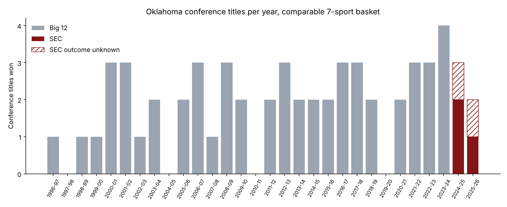
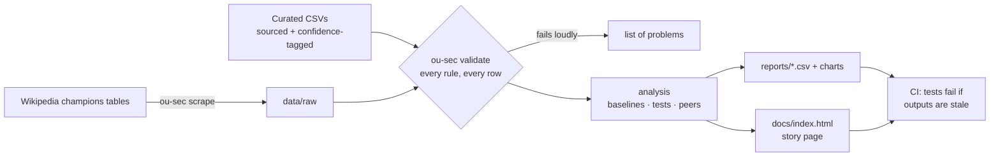

# Did Oklahoma lose ground in the SEC?

In July 2024 the University of Oklahoma left the Big 12 for the SEC, college sports' deepest conference. This project measures what happened next, using 30 years of conference history, sourced results for every SEC season, and Texas (which moved the same day) as a control group.

**[Read the story page →](docs/index.html)** (plain-English findings with interactive charts) · [Full report](reports/OU_SEC_Performance.md) · [Methodology](docs/METHODOLOGY.md)



## Findings (through 2025-26)

| | Oklahoma | Texas |
|---|---|---|
| Comparable conference titles per year, last 5 Big 12 seasons | 2.4 | 2.4 |
| Comparable conference titles per year, SEC | **1.5** | **2.5** |
| National titles in first 2 SEC years | 3 | 2 |
| Directors' Cup rank, 2024-25 / 2025-26 | 9 / 16 | 1 / 1 |

- **OU wins fewer conference titles in the SEC; Texas does not.** Both started from the same Big 12 pace.
- **Two seasons can't tell a real decline from a run of close losses.** A gap this size would happen about 29% of the time by chance (Poisson test), and the OU-vs-Texas split about 36% of the time (exact conditional test).
- **OU is still elite nationally:** back-to-back gymnastics titles and the 2026 baseball title.

## What this project demonstrates

| Skill | Where |
|---|---|
| Data collection and curation with provenance | Wikipedia scraper with failure detection; hand-curated rows each carrying a source URL and confidence level |
| Data quality engineering | Validation that lists every problem at once; unknown outcomes kept separate from losses; a supplement file that may fill gaps but never override scraped data |
| Research design | Like-for-like comparison of sports and titles; recent vs full baselines; a control group that moved conferences at the same time (Texas) |
| Statistics, with limits stated | Poisson rate test, exact conditional two-sample test, worst-case bounds for unknown outcomes, and a table of where the assumptions could fail |
| Software engineering | Installable package and CLI, 100+ tests, ruff, CI on two Python versions |
| Communication | A readable story page and a technical report, both generated from the same numbers; tests fail if either drifts |

## How it works



## Quickstart

```bash
pip install -e ".[dev]"
ou-sec validate     # check every input file, print coverage
ou-sec all          # regenerate reports/ and docs/index.html
make check          # lint + tests (what CI runs)
```

Other commands: `ou-sec report`, `ou-sec site`, `ou-sec scrape big12|sec` (needs network access to Wikipedia).

## Repository layout

```
src/ou_sec/       config · data (load + validate) · analysis · charts · site · scrape · cli
data/raw/         scraped Big 12 champions (never hand-edited)
data/curated/     SEC results, Big 12 2023-24 supplement, Directors' Cup (sourced)
reports/          generated tables, charts, and the written report
docs/             story page (index.html), methodology, data dictionary, roadmap
tests/            unit, validation, scraper (offline), site, and sync tests
```

## Limitations

Two SEC seasons is a small sample. The SEC-era rows were curated from web-search results, cross-checked where possible: 19 of 30 are high confidence, 10 medium and 1 low. Some shared Big 12 titles are probably undercounted. Details are in the [report](reports/OU_SEC_Performance.md#5-limitations), and the planned fixes are in the [roadmap](docs/ROADMAP.md).

To add a season, see [docs/DATA_DICTIONARY.md](docs/DATA_DICTIONARY.md), then run `ou-sec all`.
