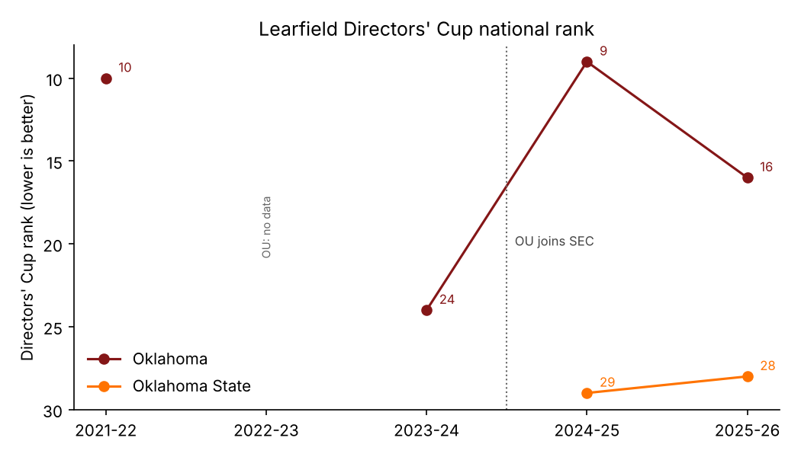

# Oklahoma in the SEC: Two Seasons In (2024-25 and 2025-26)

*Data as of October 2026. The 2026-27 season is in progress and not included. Every number below is regenerated by `python ou_analysis.py`. `tests/test_reports_in_sync.py` fails if the committed outputs or the key figures in this report drift from the code.*

## Executive summary

- **OU wins about as many conference titles as it did in the Big 12.** In the seven sports it plays in both leagues, OU won **3 SEC titles in 2 years**. Its Big 12 rate implies **3.70–4.00**. If OU had kept its Big 12 rate, a result this low or lower would happen about **45% of the time** (Poisson, p ≈ 0.43–0.49). Two outcomes are still unknown (the women's soccer SEC tournaments). Counting both as titles would only push p up to 0.79–0.83. Either way, two seasons cannot separate "the SEC is harder" from noise.
- **Softball carries almost all the titles.** All 3 comparable titles are softball: the 2025 regular season, a share of the 2025 tournament, and the 2026 regular season. Women's basketball won 9 Big 12 titles. In the SEC it went 11-5 both years and won none.
- **Gymnastics is the clearest sign that the SEC is harder.** OU won **14 Big 12 meet titles**. In the SEC it won **the NCAA title both years but lost both SEC meets**: by 0.275 to LSU in 2025 and by 0.025 to Florida in 2026. It did win the SEC regular season both years: shared with LSU at 7-1 in 2025, outright at 8-0 in 2026. The best team in the country can still lose its own conference meet.
- **National results are as good as or better than before.** OU won 3 national titles in 2 SEC years: gymnastics in 2025 and 2026, and baseball in 2026. Its Directors' Cup rank was **9th and 16th**, against 10th and 24th in its last two Big 12 years where I have data. Oklahoma State, which stayed in the Big 12, finished 29th and 28th.
- **The revenue sports are mixed.** Football went 2-6 in the SEC in 2024, then 6-2 with a playoff bid in 2025. Men's basketball finished in the bottom third both years (6-12, 7-11).
- **Bottom line (my judgment, moderate confidence):** OU has kept its national standing. It has given up some of its *conference-title* dominance, mostly in sports where it used to win the Big 12 almost by default. The data does not support either "OU is struggling in the SEC" or "nothing changed".

## 1. Data and method

| Layer | Source | Coverage | Trust |
|---|---|---|---|
| Big 12 baseline | `Championships by Season/*.csv`, scraped from Wikipedia by `big12_scrape.py` | 13 sports, 1996-97 to 2022-23 | Medium (see limitations) |
| SEC era | `oklahoma_sec/ou_sec_results.csv`, curated by hand. One row per sport-season, each with a source URL and a confidence tag | 8 sports × 2 years | Mixed, tagged per row |
| National context | `oklahoma_sec/directors_cup.csv` | OU 2021-22 to 2025-26, OSU 2024-25 to 2025-26 | High/medium |

**Why curated data, not a scrape?** The build environment could not reach Wikipedia or other sites directly. The SEC rows were built from web-search results, cross-checked where possible, with conflicting sources noted in each row's `notes` column. `sec_scrape.py` is included so the SEC tables can be scraped once network access allows.

**Data rules, enforced in code.** Every input is validated before analysis. A typo in a sport name, an invalid title flag, a non-integer record, a duplicate row, or an unsourced row stops the run and lists every problem. Title flags are `Y`, `N`, `shared`, `-` (no such event that year), or blank (unknown). **Unknown outcomes are reported separately, never scored as losses.**

**The comparable basket.** Raw title counts are not like-for-like between the conferences, so the comparison uses only sports and title types that exist in both:

| Sport | Big 12 column | SEC field |
|---|---|---|
| Baseball, Softball, M/W Basketball, W Soccer | Regular season + Tournament | Regular season + Tournament |
| Volleyball | Champion | Regular season |
| W Gymnastics | Champion (meet) | SEC Championships meet only. The SEC regular-season title is excluded because the Big 12 table has no equivalent. |

Football is not in the Big 12 scrape, so it is left out of the title comparison. Conference win % counts ties as half a win.

## 2. Big 12 baseline (1996-97 to 2022-23)

OU is **third in total Big 12 titles** in the scraped sports with 58 (11.1%), behind Texas (131) and Baylor (61). Its titles are concentrated in a few sports:

| Sport | Reg. season | Tournament/Meet | Total |
|---|---|---|---|
| Softball | 14 | 7 | 21 |
| Women's Gymnastics | — | 14 | 14 |
| Women's Basketball | 5 | 4 | 9 |
| Men's Tennis | 2 | 3 | 5 |
| Baseball / Men's Basketball / Wrestling | 0 | 3 each | 3 each |

In the comparable basket OU averaged **1.85 titles a year** over its 27-year Big 12 history and **2.00** over the last five years in the data (which include the COVID-cancelled 2019-20).

## 3. SEC era, sport by sport

| Sport | 2024-25 | 2025-26 | SEC titles | National |
|---|---|---|---|---|
| Football | 2-6 SEC, 6-7, Armed Forces Bowl L | 6-2 SEC, 10-3, CFP first round L | 0 | — |
| Softball | 17-7, **reg. season champ**, **tourney co-champ**, WCWS | 20-4, **reg. season champ**, Super Regional L | 3 | — |
| W Gymnastics | 7-1, **reg. season co-champ**, 2nd at SEC meet (−0.275) | 8-0, **outright reg. season title**, 2nd at SEC meet (−0.025) | 2 (reg. season) | **NCAA champions ×2** |
| Baseball | 14-16, 12th, regional final L | 14-16, 11th | 0 | **2026 NCAA champions** |
| W Basketball | 11-5, 4th, Sweet 16 | 11-5, 5th, Sweet 16 | 0 | — |
| M Basketball | 6-12, NCAA first round | 7-11, 11th, missed NCAA | 0 | — |
| Volleyball | 8-8, NCAA second round (no SEC tournament held) | 7-8 | 0 | — |
| W Soccer | No reg. season title; record and tournament *unknown* | 3-4-3, 9th; tournament *unknown* | 0 (2 unknown) | — |

Conference win % by sport is in `reports/ou_sec_conference_win_pct.csv`. I deliberately do not pool it across sports: softball and baseball play about 25–30 conference games and football plays 8, so a pooled figure mostly measures the diamond sports.

### What stands out

1. **Conference finish predicts postseason poorly in the SEC.** Baseball went .467 in the SEC both years. In 2026 it entered the NCAA tournament as a regional 2 seed, lost its SEC tournament opener, then won the national title. Gymnastics shows the reverse: it won nationals and lost the conference meet. Sixteen deep teams compress conference standings, so conference titles carry less information about how good a team is than they did in the Big 12.
2. **In softball, regular-season dominance did not carry into the postseason.** OU won the regular season at 20-4 in 2026 and was the NCAA No. 1 seed, then lost a home Super Regional to Mississippi State.
3. **Women's basketball held steady at 11-5 with consecutive Sweet 16s.** In the Big 12 that record often won a title. In the SEC it finishes 4th–5th behind South Carolina, Texas and LSU.

## 4. Statistical check: is the title decline real?

| Baseline | Rate/yr | Expected in 2 SEC yrs | Observed | P(≤ observed) | P if 2 unknowns were titles |
|---|---|---|---|---|---|
| Big 12 full history (27 yrs) | 1.85 | 3.70 | 3 | 0.49 | 0.83 |
| Big 12 last 5 years | 2.00 | 4.00 | 3 | 0.43 | 0.79 |

**How to read this:**
- **ELI5:** OU won one fewer title than usual. That happens about every other year by luck alone.
- **Intermediate:** A one-title shortfall over two years is well within normal year-to-year variation. For the shortfall to be significant at p < 0.05, OU would need 0 titles over the two years. The unknown soccer results can only make OU look better, not worse.
- **Advanced:** The Poisson model assumes titles are independent events with a constant rate. Both assumptions are wrong in ways that cut against each other. Titles cluster within a sport (softball's regular-season and tournament titles are correlated), which inflates variance and makes a shortfall *less* surprising. Moving to a stronger league should lower the rate, which makes a shortfall *more* expected. The test is a sanity check, not an estimate of the SEC effect.
- **Expert:** A better design would model each sport's conference finish percentile, (N − rank) / (N − 1), with sport fixed effects and a conference indicator. It would also add strength-of-league controls such as conference RPI and NET averages. That needs standings data, not title lists, and more SEC seasons. This is the most valuable next step (section 6).

## 5. Limitations and failure modes

- **2023-24 is missing from the Big 12 baseline.** The scrape stops at the 2022-23 season, so OU's final Big 12 year is absent (it won softball and gymnastics titles that year). Adding it would *raise* the Big 12 rate a little and make the SEC comparison look slightly worse.
- **Shared Big 12 titles may be undercounted.** Wikipedia lists one name with a † for some co-championships, and the original scrape dropped rows with merged cells. If OU was a co-champion but not the listed name, the title is not counted. The scraper now reports how many rows it skips, so a fresh scrape will show the size of this gap.
- **The softball "1996" row is excluded.** It maps to a year before the Big 12's first season (1996-97). If it is actually the first Big 12 season, OU's softball total is 23, not 21.
- **The SEC data is curated from search results, not primary pages.** Rows tagged `medium` or `low` have known conflicts. For example, men's basketball 2025-26 is 19-15 per OU Daily but 21-16 per Wikipedia, and baseball 2024-25 is 38-22 or 37-22. One search summary also wrongly said OU joined the SEC in 2025 (it joined on July 1, 2024), so rows were cross-checked against a second source where possible. Women's soccer is the weakest sport: the 2024-25 record and both SEC tournament results are unknown.
- **Survivorship in sport selection.** The comparison covers sports OU plays in both leagues. Wrestling, rowing and men's gymnastics are not SEC-sponsored sports, so they sit outside the SEC comparison by construction.
- **Only n = 2 seasons.** No conclusion here should be treated as settled.

## 6. Recommended next steps (in priority order)

1. **Get standings, not just champions.** Scrape each sport's final SEC and Big 12 standings to build the finish-percentile model above. This replaces a sparse binary outcome (title or no title) with a continuous one, which is far more informative over a short window.
2. **Run `sec_scrape.py` from a networked machine** to replace the curated SEC titles with scraped tables, then re-run `ou_analysis.py`. The scraper fails loudly if the page has no matching tables, but it has not been run against the live SEC page.
3. **Backfill 2023-24 Big 12, the 2022-23 Directors' Cup rank, and the women's soccer unknowns.**
4. **Add peer controls.** Texas, which joined the SEC at the same time, is the natural comparison. It finished 1st in the Directors' Cup in 2025-26. Comparing OU to Texas and to Oklahoma State separates "the SEC effect" from OU-specific factors such as coaching turnover and NIL spending.
5. **Add revenue-sport depth:** football SP+/FPI and basketball NET by year, since conference titles barely register in those sports.
